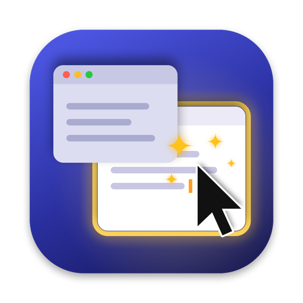
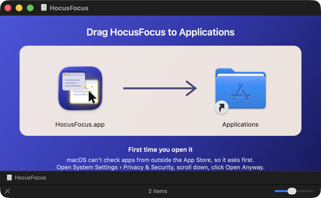
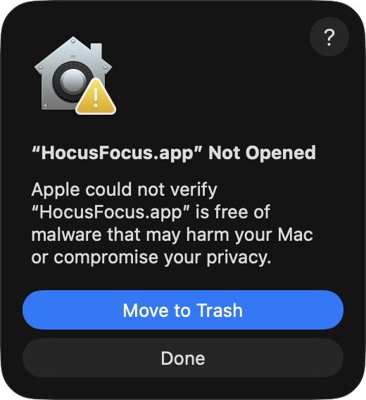
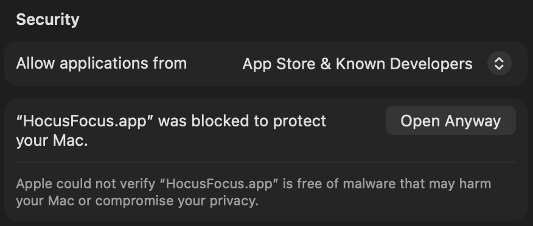

<p align="center">
  
</p>

# HocusFocus

[](https://buymeacoffee.com/stephanepoulin)

[](https://github.com/spoulin/hocus-focus/releases/latest/download/HocusFocus.dmg)

For macOS 13 or later, on Apple silicon and Intel Macs. See [Install](#install).

Focus follows the mouse on macOS, **without raising the window**. Rest the mouse on a
window, and it gets the keyboard focus. It stays where it is in the stack of windows.

[Watch the demo on YouTube](https://youtu.be/bklzxefGLa4) (under 2 minutes).

HocusFocus is a menu bar app. A command line tool, `hocusfocus`, is kept for tests and
diagnostics.

## Install

1. Click **Download** above to get `HocusFocus.dmg`, then open it.
2. Drag HocusFocus onto Applications.

   

3. Open HocusFocus from Applications. The first time, macOS says it can't check it, because it
   doesn't come from the App Store or from a developer known to Apple. Click **Done**, not
   Move to Trash.

   

4. Open **System Settings › Privacy & Security**, scroll down to **Security**, and click
   **Open Anyway** next to the message about HocusFocus. Confirm with your password or Touch ID,
   then click **Open Anyway** once more.

   

5. HocusFocus asks for Accessibility access, which it needs to follow the mouse and give the
   focus to a window: allow it in **System Settings › Privacy & Security › Accessibility**. It
   starts by itself as soon as the access is given.

Steps 3 and 4 are needed once only. Clicked Move to Trash by mistake? Open the disk image again,
drag the app onto Applications, and start over at step 3.

To update, choose **Check for Updates…** in the menu bar menu: it opens the page of the latest
version. Download it and drag it onto Applications again, replacing the old one. Every release is
signed with the same certificate, so the Accessibility access stays.

## Build and install

```bash
./build.sh
```

This builds `HocusFocus.app`, signs it, installs it in `~/Applications` and opens it. The
first time, macOS asks for Accessibility access (System Settings > Privacy & Security >
Accessibility). The app starts by itself as soon as the access is given.

`build.sh` signs with your first "Apple Development" identity, so the access stays after
each rebuild. Without one, it signs ad hoc, and you must give the access again after each
build. Options: `VERSION=1.2.0`, `UNIVERSAL=1` (Apple silicon and Intel), `NO_INSTALL=1`.

The menu (English and French):

| Item | What it does |
|---|---|
| Focus follows mouse | Turns HocusFocus on or off. The icon shows the state. |
| Mode | Focus without raising (default), or focus and raise. |
| Delay | How long the mouse must rest: 50 to 600 ms (150). |
| Pause while typing | No focus change for 300 ms, 500 ms (default) or 1 s after a key press, or off. |
| Hold to pause | Control (default), Option, Command or none. |
| Move the pointer to the app you switch to | On by default. When an app becomes active from the keyboard (⌘Tab, a shortcut, Spotlight) or from the Dock, the pointer goes to its window, on the part nearest the center that no other window covers. Without it, the next nudge of the mouse would give the focus back to the window under the pointer. A click in the app leaves the pointer where it is. Menu bar apps count too. |
| Move the pointer to new windows | On by default. When the active app opens a window that takes the focus (its settings, a dialog, a sheet, a new window), the pointer goes to it the same way, however it was opened: a menu, a shortcut, a button, a menu bar app. Windows that open in the background, menus and popovers are left alone. |
| Show a ring where the pointer lands | On by default. After HocusFocus moves the pointer, an indigo ring closes on it in half a second, so your eye finds it. With Reduce Motion on, the ring only fades. |
| Apps | All apps (default); Ignore the checked apps (they never get the focus); or Only the checked apps (no other app gets it). The open apps are listed with a checkbox; each mode keeps its own list. |
| Open at login | Starts HocusFocus when you log in. |
| Quit AutoRaise | Shown only when AutoRaise is running: both tools react to the mouse. |
| Check for Updates… | Opens the page of the latest release on GitHub. |

The settings are saved in the `local.hocusfocus` defaults. To see each decision, turn on
the log, then quit and reopen the app:

```bash
defaults write local.hocusfocus log -bool YES
```

The log is `~/Library/Logs/HocusFocus.log`. `defaults delete local.hocusfocus log` turns it
off.

### Releases

A version tag publishes a release: the Release workflow (`.github/workflows/release.yml`) builds
HocusFocus for Apple silicon and Intel, signs it, makes `HocusFocus.dmg` and attaches it to a
GitHub release, which the Download link above always points to.

```bash
git tag v1.0.0
git push origin v1.0.0
```

- Releases are signed with a self-signed certificate, "HocusFocus Release Signing", kept in the
  repository secrets `SIGNING_P12` and `SIGNING_P12_PASSWORD`. It isn't tied to an Apple
  account, so macOS asks to Open Anyway the first time; but it stays the same from one version
  to the next, so macOS keeps the Accessibility access after an update.
- To make the disk image on your Mac: `pip3 install dmgbuild`, then
  `UNIVERSAL=1 NO_INSTALL=1 ./build.sh` and
  `NAME=HocusFocus COLORS="4B55E0 2E34A7 151859" tools/make-dmg.sh build/HocusFocus.app HocusFocus.dmg`.

## Source layout

| Folder | Content |
|---|---|
| `Sources/HocusFocusCore` | The engine: finds the window under the mouse and focuses it. |
| `Sources/App` | The menu bar app. |
| `Sources/CLI` | The `hocusfocus` command line tool. |
| `Resources/*.lproj` | Menu texts, English and French. |
| `Icon` | The app icon, drawn in code (`make-icon.swift`, `make-icns.sh`). |
| `tools` | The disk image: `make-dmg.sh`, its background and its settings. |

## The command line tool

```bash
swift build
.build/debug/hocusfocus check
.build/debug/hocusfocus run --verbose
```

The terminal that runs it needs Accessibility access. Quit the app first: two instances
would both move the focus.

Commands:

| Command | What it does |
|---|---|
| `check` | Shows whether each private function was found, and whether Accessibility is allowed. |
| `list` | Lists the normal windows on screen, front to back. `*` marks the focused one. |
| `hit <x> <y>` | Shows which window would get the focus at a point, or why none would. |
| `test-focus <id>` | Focuses one window without raising it, then reports whether the focus moved and whether the stacking order changed. Exit code 0 means both are right. |
| `run` | Focuses the window under the mouse each time the mouse rests. |

Options for `run`: `--mode focus|raise`, `--dwell <ms>` (150), `--typing-guard <ms>`
(500), `--disable-key control|option|command|none` (control), `--except <id,id>` or
`--only <id,id>` (bundle identifiers), `--verbose`.

`list` also says whether the focused app shows a popup, which pauses the focus changes.

**If AutoRaise is running**, quit it first, or start hocusfocus with another disable key.
Both tools react to the mouse, and AutoRaise raises the windows.

## How it works

1. A listen-only event tap receives mouse moves, key presses, modifier keys and mouse
   buttons. There is no polling.
2. Each mouse move restarts a timer. When the mouse stays still for the dwell time, the
   tool looks at the window under the mouse.
3. It asks Accessibility which element would receive a click there
   (`AXUIElementCopyElementAtPosition`), then goes to its window (`AXWindow`, else its
   parents). Accessibility knows which windows let the mouse through. The WindowServer's
   list does not: the Dock keeps a transparent window over the whole main screen, and
   AutoJankyBorders draws borders the same way. When Accessibility gives no window, the
   tool uses the WindowServer's list (`CGWindowListCopyWindowInfo`), with only the windows
   of normal apps.
4. It does nothing when:
   - the element is in the Dock, the menu bar or a menu,
   - the window is not a normal window (layer 0),
   - the focused app has a menu, popover or modal panel open (no focus change at all,
     or the menu would close),
   - the focused app shows a dialog, sheet or secondary window, and the window under the
     mouse is another window of that same app. A secondary window is one whose minimize
     and zoom buttons are both disabled, such as a settings window: to reach it, the
     mouse often crosses the app's main window. Other apps can still take the focus,
   - the app is filtered out by the Apps setting,
   - a key was pressed less than 500 ms ago (typing guard),
   - a mouse button is down (drag, resize),
   - the disable key is held,
   - the window's subrole is not a standard window or a dialog.
5. When the mouse comes back to an app that left a dialog, sheet or secondary window
   focused (its settings, for example), that window gets the focus back instead of the
   window under the mouse, and comes to the front if another app hid it.
6. It focuses the window with three private SkyLight calls:
   - `SLPSPostEventRecordTo`: inside one app, tells the old window that it lost the focus and the new window that it got it,
   - `_SLPSSetFrontProcessWithOptions(psn, window, 0x200)`: makes the app active for that window, without bringing any window forward,
   - two more event records that make the window the key window, like a click would, but without the click.

The event record layout comes from [yabai](https://github.com/koekeishiya/yabai). The
process serial number comes from `SLSGetWindowOwner` + `SLSGetConnectionPSN` instead of the
deprecated `GetProcessForPID`.

All private functions are loaded with `dlopen`/`dlsym`. If a macOS update removes one,
`check` says so, and `run` falls back to a classic raise (`AXRaise` + activate).

## Results (macOS 26.5.2, 2026-11-14)

- All six private symbols are present.
- `test-focus`, between two TextEdit windows (same app, both ways) and with Slack (other
  app, both ways): the focus moves, and the stacking order does not change.
- Keys typed after the focus change go to the window that stays behind.
- `run`, with mouse moves simulated over a hidden TextEdit window and over another app
  (RandAmp): `focus ok`, and the stacking order does not change.

Lessons learned while testing:

- `NSWorkspace.frontmostApplication` is stale in a tool without a running main loop. The
  focused app is read through Accessibility (`kAXFocusedApplicationAttribute`).
- The mouse cursor is itself a window, owned by the WindowServer at the cursor level. The
  hit test must skip it.
- The Dock has a transparent 1920×1080 window over the whole main screen. With the
  WindowServer's list alone, every window on that screen (iTerm here) looked covered by the
  Dock. Hence the Accessibility hit test.
- Other apps keep windows at the pop-up menu level (101) that are not menus
  (AutoJankyBorders, Solpaper). Only the focused app's own windows count as popups.
  Floating "always on top" windows (layer 3) do not count either.
- In web content (Electron apps such as Claude), the element under the mouse can be more
  than 30 levels below its window. Walking up parent by parent gave up too early; the
  `AXWindow` attribute goes straight to the window.
- Accessibility often cannot tell which app is active (error -25204, 20 times out of 20
  while RandAmp's settings had the focus). The active app comes from the WindowServer
  instead (`_SLPSGetFrontProcess`, as yabai does), then its focused window from that app.
- While the screen is recorded, macOS 26 puts a 66 × 20 point window on every title bar
  (its recording indicator), which the app reports as a dialog. HocusFocus took it for an open
  dialog and kept the focus from moving inside the app. Windows smaller than 120 × 60 points are
  now ignored, as popups and as targets.
- RandAmp's settings window is a standard window for macOS, not a popup. Its disabled
  minimize and zoom buttons tell it apart from the main window.
- Claude raises its own window most times it becomes active. Focus without raise cannot
  stop it, and macOS refuses to put the windows of an inactive app back in front of the
  active one (`AXRaise` answers success and does nothing). Put such apps in the Apps
  exception list if the raise bothers you.

## Not done yet

- The Accessibility hit test does not see some windows, such as Quick Look previews. The
  window behind them can get the focus.
- Apps that raise their window when they become active: Claude here; AutoRaise lists
  JetBrains IDEs, Arc and Dia. Only the Apps exception list helps.
- Floating windows and panels are skipped.
- Popups drawn inside a window (web menus in Electron apps) are invisible to macOS. They
  do not matter: the mouse stays in the same window.
- No visual cue for the window about to get the focus, no app icon.

## License

MIT, see [LICENSE](LICENSE). The layout of the private event records comes from
[yabai](https://github.com/koekeishiya/yabai), also under the MIT license.

## Support

If HocusFocus saves you a click (or a few hundred a day), you can buy me a coffee.

<a href="https://buymeacoffee.com/stephanepoulin"></a>

Made by [Stéphane Poulin](https://www.stephanepoulin.com).
